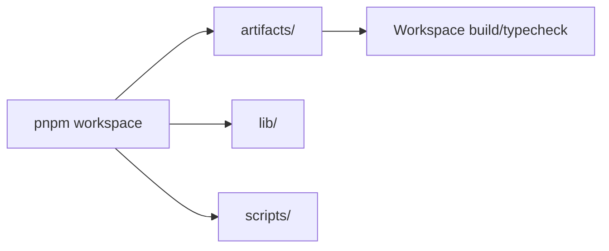

# Hacktober VVCE Vectorflow

## Overview

This repository is a collaborative event web application organized as a pnpm workspace. It contains reusable artifacts, libraries, scripts, and deployment configuration for the Hacktoberfest/VVCE project.

## Architecture



## Technology stack

The repository uses TypeScript/JavaScript workspace tooling, pnpm, and package-level build/type-check scripts. Confirm package-specific dependencies in the workspace manifests before extending a package.

## Setup

```bash
pnpm install
pnpm run build
```

The root package enforces pnpm and runs workspace type checking/build steps.

## Project structure

- `artifacts/` — application/workspace artifacts.
- `lib/` — shared libraries.
- `scripts/` — project scripts and setup helpers.
- `pnpm-workspace.yaml` — workspace definition.
- `render.yaml` — deployment configuration.

## Status

Event project/prototype.

## License

No license is currently declared.
